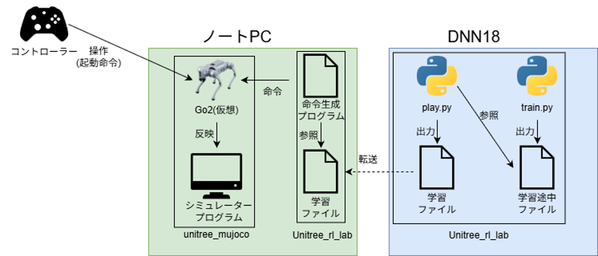

# 導入

## 本資料について

四足歩行型ロボット「Unitree Go2」のPhysical AI開発で筆者が実際に遭遇した問題と，その解決方法をまとめた資料である．Physical AIと強化学習を学び始める読者が同じ失敗を繰り返さず，効率的に学習を進められることを目的とする．

### 要点まとめ

| 分類 | 失敗 | 教訓 |
| --- | --- | --- |
| 環境構築 | Isaac Sim / Isaac Lab / unitree\_rl\_lab のバージョン競合 | 導入前にREADMEで対応バージョンを確認する |
| 環境構築 | WSL・仮想環境での開発 | GPUを使う大規模開発は実機OS（Ubuntu）で行う |
| 強化学習 | Actorの観測に実機で取れない情報を入れた | Actorは実機センサ情報のみ，特権情報はCriticだけ |
| 強化学習 | 回転速度のカリキュラムが速すぎた | 命令の難易度は各成分で揃えて段階的に上げる |
| 強化学習 | 階段を上らない方が得になった | 移動指示中の停止にペナルティを課す |
| 強化学習 | 足上げ目標高さ20cmで動かなくなった | ロボットの可動域を考慮して報酬を設計する |
| 強化学習 | 報酬関数と損失関数を間違えた想定と逆方向の学習を行った | 損失関数なのか報酬関数か記録 |
| 強化学習 | 禁止接触抑制をかけすぎて階段が登れなくなった | 抑制はかけすぎない|

## 使用環境とアーキテクチャ

### 使用環境

強化学習の本番はGPUを搭載したデスクトップPC（Ubuntu）で実施した．WSL環境は非推奨である．

| 項目 | ノートPC（WSL）※非推奨 | ノートPC（Ubuntuデュアルブート） | デスクトップPC |
| --- | --- | --- | --- |
| 機種 | ThinkPad X1 | Let's note CF-FV | — |
| OS | Windows 11 Home + WSL2（Ubuntu 24.04.4 LTS） | Ubuntu 24.04 LTS | Ubuntu 24.04.4 LTS |
| CPU | AMD Ryzen 7 PRO 8840U w/ Radeon 780M Graphics（3.30 GHz） | 13th Gen Intel Core i7-1360P × 16 | Intel Evo i5 |
| GPU | — | — | NVIDIA RTX PRO 6000 Blackwell |
| RAM | 32 GB | 16 GB | 125 GiB |
| Python | 3.11 | — | 3.11 |
| 備考 | 有線通信 | — | — |

> 注：WSL環境でも強化学習自体は可能だが，「強化学習過程の確認」と「シミュレーションの操作」ができなくなるため非推奨．

### 使用したアーキテクチャ

導入方法は当研究室学生の資料[「Unitree Go2を題材とした強化学習の実施」](../unitree-Go2-Reinforcement-Learning/01_概要.md)を参照．

- unitree\_sdk2
- unitree\_mujoco
- Isaac Sim
- Isaac Lab
- unitree\_rl\_lab

**最終的なシステム構成図**：\

