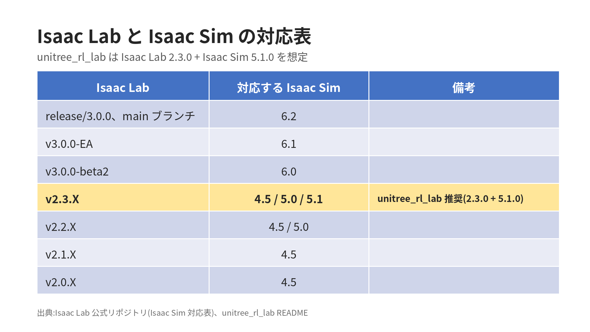

# 試行錯誤集（環境構築）

強化学習を始める前の環境構築の段階で，重要な失敗をした．強化学習に限らず様々な開発に応用できる教訓のため記述しておく．

## 1. アーキテクチャのバージョン競合

**問題**：Isaac Sim，Isaac Lab，unitree\_rl\_lab には互いに対応するバージョンがある．調べずにインストールした結果，ライブラリ不足とバージョン競合のエラーが発生した．

**教訓**：

- 前提となるアーキテクチャがある場合は，インストール前にREADMEをよく読む
- Python等のプログラミング言語にもバージョン指定がある場合があるので注意する

同じアーキテクチャを使用する場合，以下のバージョン対応表に従えば競合は発生しない（2026/11/01 時点）．\

## 2. 実行環境の選択

機械学習では多数のライブラリとアーキテクチャを使うため，実行環境をよく考慮する必要がある．

### 2-1. WSLの使用

開発当初はUbuntuをOSとしてインストールせず，WSL上に導入して開発を進めてしまった．その結果，以下の致命的な問題が生じた．

| 発生した問題 | 影響 |
| --- | --- |
| Isaac Labから学習過程の映像を出力できない | **学習過程を分析できない** |
| コントローラを認識しない | **シミュレータを操作できない** |
| ドライバのバージョンによってはGPUを認識しない | **強化学習自体を行えない場合がある**．ドライバを不安定な非推奨バージョンに落とす必要がある |

### 2-2. 仮想マシンの使用
 
Windows 11上でVirtual Boxを使用した．WSLより安定して動作し，コントローラも認識するようになった．しかしGPUを認識せず，計算資源が足りないためシミュレータを動かせなかった．

**教訓**：GPUを使い，安定かつ大量の計算資源が必要なPhysical AI開発では，実機環境を使用すべき．

補足：Windows環境で使える仮想マシン「HyperV」ではGPUを認識させることができるらしい．VirtualBoxを使う理由がなければ使ってみてもいいかも（現時点で非検証）

