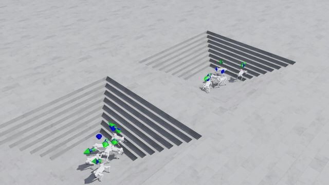
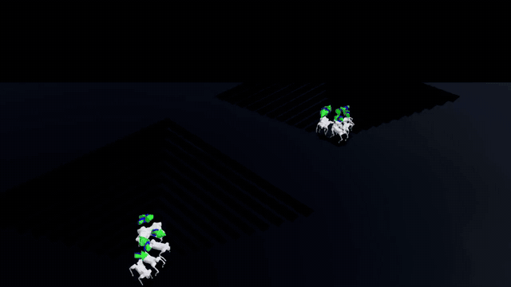
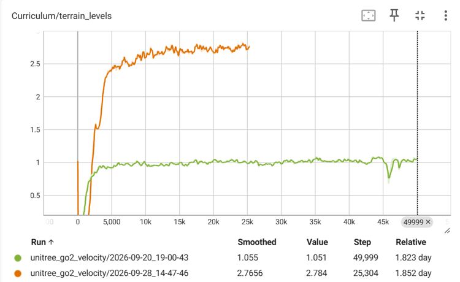
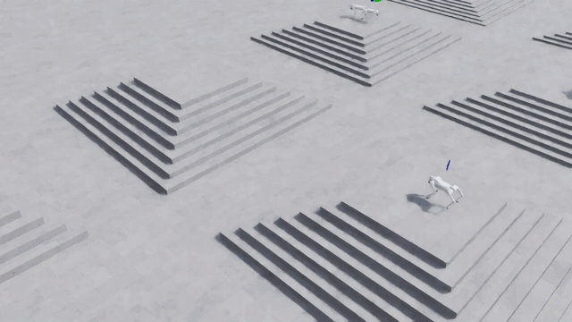
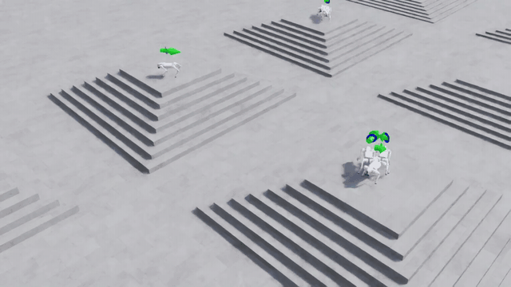
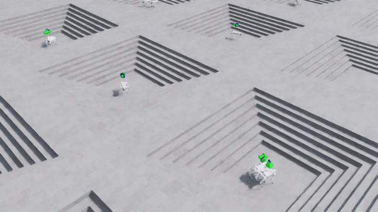

# 試行錯誤集（強化学習）

強化学習では学習アルゴリズム，報酬・損失関数，方策と価値関数など，考慮すべき要素が多い．本章では発生した問題の一部と，実施した対策・結果を示す．

## 1. Actor（方策）と Critic（価値関数）の入力の誤解

unitree\_rl\_lab では，学習時にのみ使う価値関数（Critic）の入力と，実機に載せる方策（Actor）の入力が分けて設計されている．この手法は Actor-Critic と呼ばれ，PPOアルゴリズムを用いた強化学習でよく採用される．

|  | Actor（方策） | Critic（価値関数） |
| --- | --- | --- |
| 使われる場面 | 学習時＋実機 | 学習時のみ |
| 入力できる情報 | 実機のセンサで取得できる情報のみ（ロボットごとに要調査） | シミュレーションでしか得られない特権情報も可 |
| 特権情報を入れると | 実機で重みが使えなくなる | 価値の推定が安定する |

**失敗**：Actorの観測に，実機では直接取得できない情報を含めてしまった．設計の初期段階でこの区別を整理していなかった．

**結果**：学習結果に大きな変化はなかったが，学習した重みを実機で使えなかった可能性がある．一回の学習に半日以上かかることもあり，時間を無駄にしただけになった．

## 2. 命令難易度の差による学習失敗（カリキュラム）

カリキュラムとは，学習の段階に応じて地形や命令の難易度を上下させる仕組みである．今回は速度追従タスク（回転速度と前後左右の移動速度をエージェントごとにランダムに指定）を学習させた．

| 設定 | 回転速度（初期値, 最大値） | 移動速度（初期値, 最大値） | 結果 |
| --- | --- | --- | --- |
| 対策前 | (1.0, 1.0) | (0.1, 0.6) | 円を描く動きが強まり，地形難易度の成長条件を満たせず学習が停滞 |
| 対策後 | (0.1, 1.0) | (0.1, 0.6) | 円を描く動きが緩和された |

**教訓**：カリキュラムが不適切だと学習が正しく進まない．各命令の難易度は揃えて段階的に上げる．

**（緑の矢印＝命令された移動速度，青の矢印＝各エージェントが判断した移動速度）．**

## 3. 探索的行動をしなくなる失敗

カリキュラムは，階段の高さが7〜18cmで成長し，奥行は27cmで一定とした．

**問題**：対策なしでは「階段を上らない方が損失が少ない」と学習し，階段を上ろうとせず探索的な行動をしなくなった．地形難易度が上がらず，学習がまったく進まなかった．

**対策**：移動命令が出ているのに移動速度が0.3 m/s未満の場合に罰を与えるペナルティ（stall\_penalty）を追加した．

**結果**：学習が進むようになり，地形難易度の最大値が **1.05 → 2.76** に上昇した（最大値10）．ただし，それ以上上がる前に収束した．階段を上る正しい動きを学習できない原因は他にもあることがわかった．改善後の学習過程・結果は以下の動画とグラフを参照．

## 4. 報酬関数の設計ミス（足上げ目標高さ）

階段を登る動作を促すため，足を上げた高さが目標高さに近いほど報酬が増える関数（feet\_height）を設計した．

| 目標高さ | 結果 |
| --- | --- |
| 20 cm | 正しい歩行が学習されず，学習中にエージェントが動かなくなった(以下の動画参照) |
| 15 cm | 挙動が改善された |

**原因（推測）**：目標高さがGo2の足の可動域を大きく超えていた．

**教訓**：報酬・損失関数を設計するときは，学習させるロボットの仕様も考慮する．

## 5. 報酬関数の設計ミス（Z軸方向の余計な動き抑制）

上下方向の無駄な動きを抑制するため，足以外の部位（頭・股関節・大腿・すね）が地面や障害物に接触した場合のペナルティを設計した

| 損失 | 結果 |
| --- | --- |
| 1.0 | 正しい歩行が学習されず，その場でエージェントが跳ね続けた(以下の動画参照) |
| -1.0 | 挙動が改善された |

**原因**：損失関数と報酬関数の認識ミス．関数に与える重みの正負を逆にしてしまった

**教訓**：報酬・損失関数を設計するとき，損失関数なのか報酬関数なのか記録しておく

## 6. 報酬関数の設計ミス（禁止接触抑制）

禁止されている接触を抑制するため，胴体の上下（z軸）方向の並進速度へのペナルティ（base\_linear\_velocity）を設計した．

| 損失 | 結果 |
| --- | --- |
| 1.5 | 脛接触ペナルティが強いため，階段接触時にのけぞる挙動が見られた
(以下の動画参照) |

**原因**：損失関数の重みが大きすぎた(要パラメータチューニング)

## 付録：使用した報酬・ペナルティ項一覧

| 種類 | 関数名 | 説明 |
| --- | --- | --- |
| task（速度追従） | track\_lin\_vel\_xy | 前後・横方向の速度が指令値にどれだけ近いかを評価する報酬（誤差が小さいほど高評価） |
| task（速度追従） | track\_ang\_vel\_z | 旋回速度（yaw）が指令された角速度にどれだけ近いかを評価する報酬 |
| task（速度追従） | stall\_penalty | 移動を指示されているのに実速度が閾値未満（＝動いていない）の場合のペナルティ |
| base（余計な動き抑制） | base\_linear\_velocity | 胴体の上下（z軸）方向の並進速度へのペナルティ．跳ねる動きを抑制 |
| base（余計な動き抑制） | base\_angular\_velocity | 胴体のロール・ピッチ方向の角速度へのペナルティ．ぐらつきを抑制 |
| base（余計な動き抑制） | joint\_vel | 各関節の角速度へのペナルティ．無駄に速い関節動作を抑制 |
| base（余計な動き抑制） | joint\_acc | 各関節の角加速度へのペナルティ．急激な加減速を抑制 |
| base（余計な動き抑制） | joint\_torques | 各関節のトルクへのペナルティ．過剰な力みを抑え省エネな動きを促す |
| base（余計な動き抑制） | action\_rate | 前ステップとの行動の変化量へのペナルティ．不自然な変化を抑制 |
| base（余計な動き抑制） | dof\_pos\_limits | 関節角度がソフトリミットを超えたことへのペナルティ（重み大：安全装置） |
| base（余計な動き抑制） | energy | 消費エネルギー（\|角速度\|×\|トルク\|の総和）へのペナルティ |
| robot（姿勢安定性） | flat\_orientation\_l2 | 胴体が水平を保てているかへのペナルティ．重力方向とのズレが大きいほど罰則増 |
| robot（姿勢安定性） | joint\_pos | 関節角度の初期姿勢からのズレへのペナルティ．静止時は罰則5倍 |
| feet（接地・遊脚） | feet\_air\_time | 足の滞空時間への報酬．小刻みすぎる歩行を防ぐ |
| feet（接地・遊脚） | air\_time\_variance | 各足の滞空・接地時間のバラつきへのペナルティ．不均等な歩き方を抑制 |
| feet（接地・遊脚） | feet\_slide | 接地中の足が滑ることへのペナルティ |
| feet（接地・遊脚） | feet\_height | 振り出し中の足が目標高さまで上がっているかを評価（階段対策） |
| other（禁止接触） | undesired\_contacts | 足以外の部位（頭・股関節・大腿・すね）が地面や障害物に接触した場合のペナルティ |
