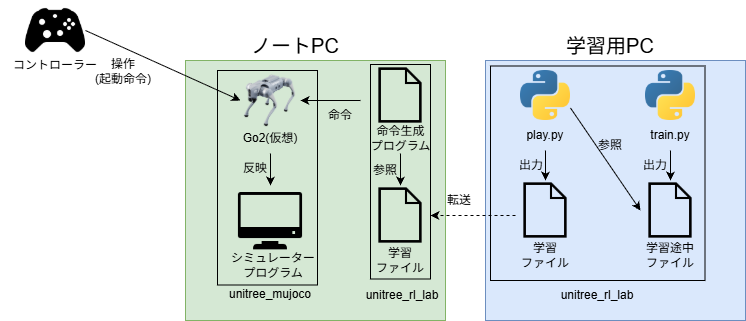

# 1. 概要

本ページは，「Unitree Go2」ロボットを題材とした，ロボット強化学習環境の構築手順や学習・検証手法をまとめたものである．

Unitree Go2は，Unitree Robotics社が開発した，四足歩行ロボットである．

参考リンク：[Go2の製品ページ](https://techshare.co.jp/product/unitree/go2/)

## 対象読者・前提知識

- 情報系学部3年以上の水準の知識
- Linuxの基本的な操作ができる
- Pythonの基礎知識

## 章構成

| 章 | 作業するPC |
| --- | --- |
| [1. 概要](./01_概要.md) | ― |
| [2. Unitree Go2強化学習用セットアップ](./02_強化学習環境セットアップ.md) | 学習用PC |
| [3. シミュレーション環境のセットアップ](./03_シミュレーション環境のセットアップ.md) | ノートPC |
| [4. 強化学習チュートリアル](./04_強化学習のチュートリアル.md) | 学習用PC |
| [5. 強化学習の実行](./05_強化学習の実行.md) | 学習用PC |
| [6. 強化学習結果の観察](./06_強化学習結果の観察.md) | 学習用PC |
| [7. シミュレーター環境での実行](./07_シミュレーター環境での実行.md) | 学習用PC・ノートPC |
| [8. 強化学習の流れ](./08_強化学習の流れ.md) | ― |

## 実行環境

### ハードウェア

- **ノートPC(Ubuntuデュアルブート)**

| 環境 | 環境名 |
| --- | --- |
| OS | Ubuntu 24.04.4 LTS |
| CPU | 13th Gen Intel® Core™ i7-1360P（16スレッド） |
| RAM | 16GB |
| 使用機種 | Let’s note CF-FV |

- **デスクトップPC**

| 環境 | 環境名 |
| --- | --- |
| OS | Ubuntu 24.04.4 LTS |
| CPU | Intel(R) Core(TM) Ultra 9 285K |
| GPU | NVIDIA RTX PRO 6000 Blackwell |
| RAM | 128GB |

- **使用機材**
  - Unitree Go2
  - ゲームコントローラー：Logicool Gamepad F310

### ソフトウェア

| ソフトウェア | バージョン |
| --- | --- |
| NVIDIA Driver | 580.178.04 |
| CUDA | 13.0(ドライバ) |
| Python | 3.11 |
| PyTorch | 2.7.0+cu128 |
| Isaac Sim | 5.1.0 |
| Isaac Lab | v2.3.2 |
| rsl-rl | 3.1.2 |
| unitree_rl_lab | 4960b84 |
| unitree_sdk2 | c753829 |
| unitree_mujoco | 1eb6642 |
| MuJoCo | 3.3.6 |
| onnxruntime | 1.22.0 |

※ unitree_rl_lab・unitree_sdk2・unitree_mujoco は GitHub のコミットハッシュを記載している．

## システム構成図

