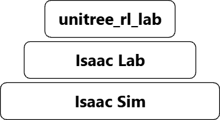
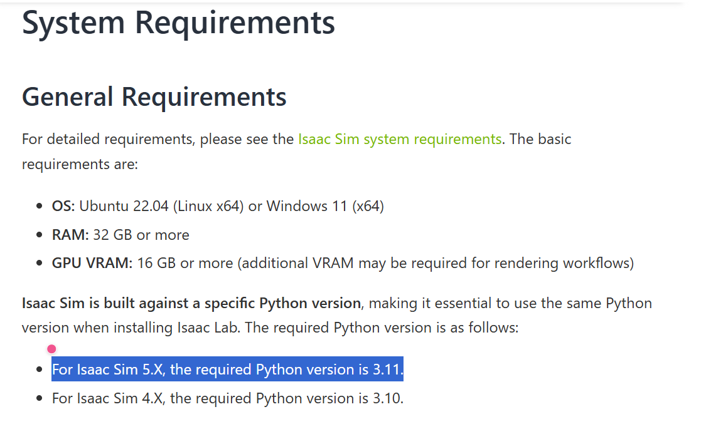
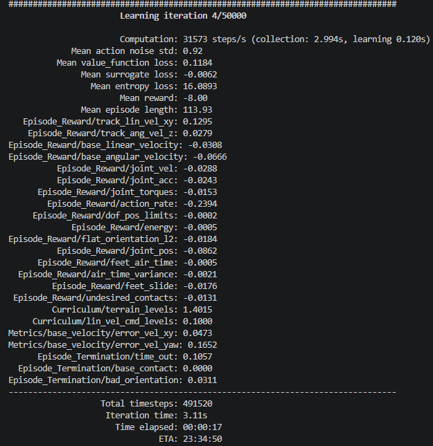

# 2. Unitree Go2強化学習用セットアップ

## 概要

この章では，Unitree Go2の強化学習環境を構築するための手順について記述する．この章を完了することで，Isaac Sim上でUnitree Go2の強化学習環境を構築することができる．

## 前提条件

学習用のデスクトップPC（NVIDIA GPU搭載，Ubuntu 24.04）で動作を確認した．

## 理論背景

### インストールするソフトウェアと機能

#### NVIDIAドライバ

NVIDIA製のGPUを認識し，効率よく使用するために必要なソフトウェア．後述するが，Isaac Sim等のソフトウェアはNVIDIA製のGPUを使用することを前提としているため，必須である．

#### conda 

パッケージ管理システムで，Pythonのバージョンやライブラリのバージョンを仮想環境ごとに切り替えることができるソフトウェアである．強化学習や機械学習のライブラリは，必要なフレームワークやライブラリのバージョン依存関係が複雑であり，システム環境に直接入れた場合に，予期せぬアップグレード等により機能しなくなることがある．そのため，condaを使用して仮想環境を作成し，その中で必要なライブラリをインストールすることで，システム環境を汚さずに強化学習環境を構築することができる．

#### Isaac Sim

PhysXによる物理演算，GPUを用いた高速なレンダリング，センサーシミュレーション，Python APIを提供するシミュレーター．
PhysXは，NVIDIAが提供する物理演算エンジンである．

#### Isaac Lab

Isaac Simの上で動作する強化学習用のフレームワークである．Isaac SimのPython APIを用いて，強化学習の学習環境を構築することができる．

#### unitree_rl_lab

Unitree公式が提供するUnitree製品の強化学習用フレームワークである．Isaac Labの上で動作する．

Isaac Sim，Isaac Lab，unitree_rl_labの関係を以下の図に示す．



## 環境構築の実施

### NVIDIAドライバのインストール

最新版のドライバでないとGPUが認識されない場合があるため，以下のリンクからNVIDIAドライバをダウンロード・インストールする．

[NVIDIA 公式ドライバー](https://www.nvidia.com/ja-jp/drivers/)

ドライバをセットしたら以下のコマンドを入力．

```bash
nvidia-smi
```

搭載しているGPUの情報が表示されれば導入完了である．GPUの情報が表示されない場合は，ドライバのバージョンを変更して再度確認する．
ドライバのバージョンは，[概要](./01_概要.md)を参照すること．

### 基礎パッケージの導入

開発環境が整っているPCでは不要な場合もあるが，本資料では一からのセットアップを想定して記載する．

以下のコマンドを入力．

```bash
sudo apt update && sudo apt upgrade -y

sudo apt install -y build-essential cmake git curl wget git-lfs

git lfs install
```

1. パッケージのアップデート
2. 強化学習に関わらず，開発に必要な汎用性の高いパッケージをダウンロード
3. 巨大なデータを管理するためのgitの拡張機能をダウンロード

**注：git lfsをインストールし忘れると以降のパッケージ，ライブラリが正しく導入されません**

### 仮想環境の構築

システム環境を汚さないようにするため，仮想環境として**conda**を導入する

(パッケージ依存がシビアであるため，最小構成のminicondaを使用する)

以下のコマンドを入力

```bash
mkdir ~/(任意のフォルダまでのパス)

wget https://repo.anaconda.com/miniconda/Miniconda3-latest-Linux-x86_64.sh -O ~/(作成したフォルダまでのパス)/miniconda.sh

bash ~/(作成したフォルダまでのパス)/miniconda.sh -b -u -p ~/(作成したフォルダまでのパス)

~/(作成したフォルダまでのパス)/bin/conda init bash
```

1. conda本体をダウンロードするためのフォルダ作成
2. インストーラ本体のダウンロード
3. インストーラの実行
4. どのディレクトリからでも仮想環境に入れるようにする初期設定

以上でcondaの導入完了．

また，仮想環境の作成方法について記述しておく．

必要なPythonのバージョンについては，使用するIsaac Simのバージョンに依存するため，各自調べること．

[https://isaac-sim.github.io/IsaacLab/main/source/setup/installation/index.html](https://isaac-sim.github.io/IsaacLab/main/source/setup/installation/index.html)

今回は，5.x系を使用するため，Python 3.11を使用することとする．



出典：[Isaac Lab Documentation](https://isaac-sim.github.io/IsaacLab/main/source/setup/installation/index.html)（© The Isaac Lab Project Developers，BSD-3-Clause）

以下のコマンドを入力

```bash
conda create -n isaaclab python=3.11 -y
# 利用規約への同意を求められた場合は，-y を外して対話モードで実行する

conda activate isaaclab
```

このコマンドにより，仮想環境の作成と仮想環境の有効化が行われる．また，今回はisaaclabという仮想環境名に設定している．以降，指示がなければこのまま仮想環境上で作業を行う．

**注：python=3.11と明記しないと以降の作業でバージョン競合が発生します**

次に，pipで依存パッケージをインストールする．

具体的なバージョンが指定されているため，公式ドキュメントを参照しつつインストールしてください．

[https://isaac-sim.github.io/IsaacLab/main/source/setup/installation/pip_installation.html](https://isaac-sim.github.io/IsaacLab/main/source/setup/installation/pip_installation.html)

本資料では以下のコマンドを使用した．

```bash
pip install -U torch==2.7.0 torchvision==0.22.0 --index-url https://download.pytorch.org/whl/cu128
python -c "import torch; print(torch.zeros(3).cuda() + 1)"
# tensor([1., 1., 1.], device='cuda:0')と出れば成功
```

### Isaac Simのインストールとパス設定

```bash
pip install "isaacsim[all,extscache]==5.1.0" --extra-index-url https://pypi.nvidia.com

python -c "import isaacsim"

# 以下は環境変数ISAACSIM_PATHを設定するコマンド（pipでインストールした場合は不要な可能性がある）
export ISAACSIM_PATH=$(python -c "import isaacsim; import os; print(os.path.dirname(isaacsim.__file__))")

echo "export ISAACSIM_PATH=\"${ISAACSIM_PATH}\"" >> ~/.bashrc

source ~/.bashrc
```

1. Isaac Sim本体のインストール（`"isaacsim[all,extscache]==5.1.0"` で依存パッケージを含めてバージョンを指定）
2. インストール確認(と，Isaac Simの利用規約同意)
3. Isaac Simのインストール先の探索，パスを変数に入れる
4. ~/.bashrcへIsaac Simのパスを記録
5. 変更の反映

以下のコマンドを入力することによりIsaac Labのインストールを行う．インストール先のフォルダには分かりやすい名前を付けることを推奨する．

```bash
mkdir -p ~/workspace(任意のフォルダ名)

cd ~/workspace(作成したフォルダ名)

git clone -b v2.3.2 https://github.com/isaac-sim/IsaacLab.git

cd IsaacLab
```

1. Isaac Labインストール先のフォルダをホームディレクトリの一つ下の階層に作成．
2. 作成したフォルダに移動．
3. Isaac Lab(2.3.×系)本体のダウンロード
4. Isaac Lab本体のフォルダに移動

**注：Isaac Labをダウンロードしたフォルダは削除しないこと．削除するとIsaac Labが動作しなくなる．**

### Isaac Labを仮想環境に導入

以前作成した仮想環境上にIsaac Labの環境を整え，ダウンロードする．

以下のコマンドを入力．

```bash
conda activate isaaclab
./isaaclab.sh --install
```

1. (仮想環境を抜けていた場合は仮想環境に入る)
2. Isaac Lab本体を仮想環境に導入

※補足

新しい環境でインストールしたところ，**ModuleNotFoundError（モジュールが見つからないエラー）が発生した**．これは，Pythonのパッケージ作成ツールであるsetuptoolsの最新版で，一部のモジュールが含まれなくなったことが原因と考えられる．

そのため，古いバージョンのsetuptoolsを使用することで解決できる．筆者の環境では，下記のコマンドで解決できた．

```bash
pip install "setuptools<81" wheel
pip install flatdict==4.0.1 --no-build-isolation
pip install "packaging==23.0" --no-deps
```

その後，Isaac Labを編集可能モード（-e）で再インストールする．

```bash
cd ~/workspace/IsaacLab
pip install -e source/isaaclab
```

セットアップが終わったら，下記のコマンドで環境のパッケージ構成（バージョン）を保存しておくことを推奨する．環境に問題が発生した際に，元の構成へ戻すための記録として利用できる．

```bash
pip freeze > ~/workspace/isaaclab-working-$(date +%Y%m%d).txt
```

起動確認（30分程度かかる）

```bash
cd ~/workspace/IsaacLab
./isaaclab.sh -p scripts/tutorials/00_sim/create_empty.py --headless
# [INFO]: Setup complete...が出たら成功
```

### Unitree製品用拡張パッケージ「unitree_rl_lab」の導入

```bash
cd ~/workspace(任意のフォルダ名．Isaac Labと同じフォルダにすると管理しやすい)
git clone https://github.com/unitreerobotics/unitree_rl_lab.git
cd unitree_rl_lab
./unitree_rl_lab.sh -i 
```

1. インストールさせたいフォルダに移動
2. unitree_rl_lab本体をダウンロード
3. ダウンロードしたフォルダに移動
4. unitree_rl_labを仮想環境に導入

### Go2の3Dモデルデータの紐づけ

unitree_rl_labを使用するには，強化学習を行うUnitree製品の3Dモデルとその紐づけが必要である．以下に導入方法を記述する．

以下のコマンドを入力

```bash
cd ~/workspace(任意のフォルダ名．Isaac Labと同じフォルダにすると管理しやすい)

git clone https://huggingface.co/datasets/unitreerobotics/unitree_model
```

1. 導入先フォルダへの移動（Isaac Labと同じフォルダを推奨）
2. Unitree製品の3Dモデルをインストール

その後，「~/workspace(unitree_rl_labインストール先)/unitree_rl_lab/source/unitree_rl_lab/unitree_rl_lab/assets/robots/」の中にある「unitree.py」の中身を以下のように編集する．

```python
# 変更前
UNITREE_MODEL_DIR = "path/to/unitree_model"

# 変更後（パスは現在の環境に合わせる）
UNITREE_MODEL_DIR = "/home/usr_name/workspace/unitree_model"
```

## 実行結果例

ターミナル上で以下のコマンドを実行する．

```bash
cd ~/workspace/unitree_rl_lab
python scripts/rsl_rl/train.py --task Unitree-Go2-Velocity --headless
```
以下のような実行結果が得られたら環境設定完了．実行したスクリプトは強化学習を実行するスクリプトのため，動作を確認できたら「Ctrl + C」で終了してよい．


