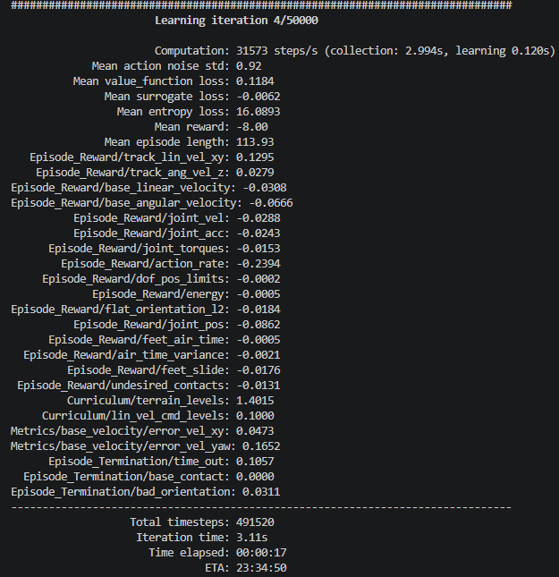

# 5. 強化学習の実行

## 概要

本章では，2章で構築した強化学習環境を用いて，Unitree Go2の強化学習を実行する手順について記述する．

## 前提条件

2章の環境構築が完了していること．本章では，学習用PC（NVIDIA GPU搭載，Ubuntu 24.04）で作業する．

## 実行方法

### 起動オプション

train.pyの主な起動オプションを以下に示す．すべてのオプションは`python scripts/rsl_rl/train.py --help`で確認できる．

|起動オプション名|説明|
|---|---|
| --task | 学習させるタスク名を指定する．Go2の場合は`Unitree-Go2-Velocity`を指定する． |
| --headless | 画面（GUI）を表示せずに実行する．SSH接続先などディスプレイのない環境で使用する．描画をしない分，処理も軽くなる． |
| --num_envs | 並列に動かすシミュレーション環境の数を指定する．省略した場合はタスクの環境設定の値が使われる．GPUのメモリが不足する場合は値を小さくする． |
| --max_iterations | 学習のイテレーション（方策の更新）回数を指定する．省略した場合は4章の`rsl_rl_ppo_cfg.py`にある`max_iterations`の値が使われる． |

### 強化学習用のスクリプト起動

```bash
conda activate isaaclab
cd ~/workspace/unitree_rl_lab
python scripts/rsl_rl/train.py --task Unitree-Go2-Velocity --headless
```

train.pyは強化学習を実行するプログラム本体である．

SSH接続が切れると強化学習のプログラムも停止してしまうため，接続が切れても実行を継続できるコマンドを使用するとよい．ここでは「nohup」を使用する．

```bash
nohup python scripts/rsl_rl/train.py --task Unitree-Go2-Velocity --headless &
```

### 学習の停止・進捗の確認

nohupで実行した場合，標準出力は「nohup.out」としてカレントディレクトリに出力される．学習の進捗を確認するには，以下のコマンドを入力する．

```bash
tail -100 nohup.out
```

nohupコマンドで実行したプログラムを停止するには，以下のように，実行したコマンドのpidを確認し，killコマンドで停止する．

```bash
ps aux | grep train.py # pidを確認
kill <pid> # pidを指定して停止
```

### 学習ファイル出力先

```bash
cd ~/workspace/unitree_rl_lab/logs/rsl_rl/unitree_go2_velocity/<日時>/
```

ファイルの中身は下記の構造で保存される．

```text
<日付>
.
├── events.out.tfevents.1790563522.<ホスト名>.599722.0
├── exported        # play.pyでエクスポートされた学習済み方策のファイルが格納される
│   ├── policy.onnx # 学習済み方策のONNXファイル
│   └── policy.pt   # 学習済み方策のTorchScriptファイル
├── git
│   └── unitree_rl_lab.diff
├── model_0.pt     # 学習途中の方策ファイル
├── ...
├── model_10000.pt
├── params          # 学習時の設定ファイル
│   ├── agent.yaml
│   ├── deploy.yaml
│   ├── env.yaml
│   └── velocity_env_cfg.py
└── videos
    └── play
        └── rl-video-step-0.mp4 # play.pyで出力した動画(第6章で説明)
```

## 実行結果例



### 途中から学習を再開する

`--resume`オプションを使用することで，途中から学習を再開することができる．再開される学習は，最も新しい日付の`unitree_rl_lab/logs/rsl_rl/unitree_go2_velocity/<日時>/`の途中学習ファイルが使用される．

```bash
python scripts/rsl_rl/train.py --task Unitree-Go2-Velocity --headless --resume
```
