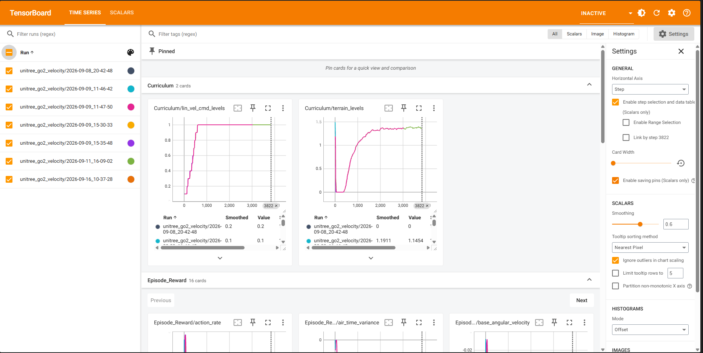
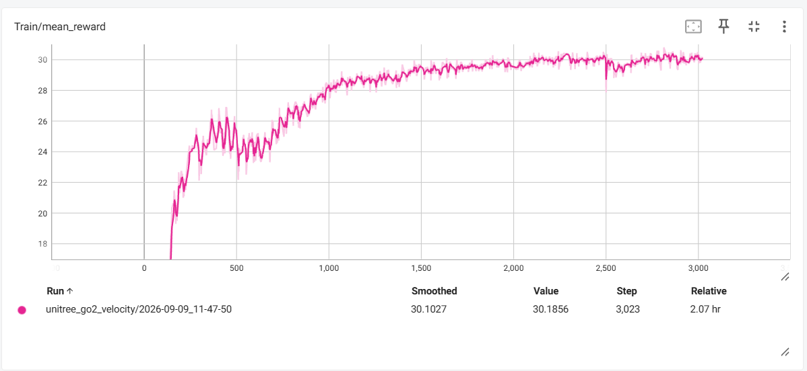

# 6. 強化学習結果の観察

## 概要

本章では，第5章で学習した強化学習済みの方策を用いて，学習の進捗や学習結果をIsaac Lab上で観察する手順について記述する．

## 前提条件

第5章の強化学習の実行が完了していること．本章では，学習用PC（NVIDIA GPU搭載，Ubuntu 24.04）で作業する．

## 評価手法

強化学習の学習の進捗や評価を行うにあたり，以下の2種の方法を用いることができる．

1. TensorBoardを用いた学習の経過観察
2. Isaac Lab上での学習結果の観察

### TensorBoardを用いた強化学習の経過観察

実行中のステータスなどをグラフ化してくれるツールとして，TensorBoardというものがあるので，これを利用する．このツールはPythonのライブラリであるため，仮想環境等にインストールしてから起動する必要がある．

以下でインストール可能

```bash
# python仮想環境内で
conda install tensorboard
```

`tensorboard` の起動方法には以下のコマンドを入力

```bash
tensorboard --logdir ~/workspace/unitree_rl_lab/logs/rsl_rl --port 6006
```

以下のような画面が出現する．




### 強化学習の経過観察（TensorBoardの見方）

強化学習を実行している際，**「学習が正しく進んでいるか」・「学習のどこが問題だったか」を確認する**ために**TensorBoard**を用いる．項目の数が多いため，経過観察時によく見る一部の項目の説明を記述しておく．

#### Curriculum：

この項目ではCurriculumCfgで適用したカリキュラムがステップごとにどのような推移で変化していったかを確認できる．安定して増加傾向にあるのが理想．階段など難易度が設定されている地形を使って学習させる場合は，設定した最高難易度まで「terrain_levels」が増加傾向にあるかを確認することを推奨する．

#### Episode_Reward：

RewardsCfgで設定した報酬・損失関数が各ステップごとに生成した報酬・損失の推移を示している．学習に問題があった際はどの報酬・損失関数に問題があるかを確認するためにこの項目を確認する．

#### Episode_Termination：

各ロボットがどのように学習を終えたかが示される．初期状態では転倒(base_contact)，不適切な姿勢(bad_orientation)，タイムアウトによって発生した学習の終了回数を確認することができる．これによって学習がうまくいっているかの情報が得られる．最終的にはタイムアウトが一番多くなることが望ましい．

#### Train：

強化学習の学習全体の進捗を表す大まかな指標を示す項目となっている．各イテレーションで得られた報酬の推移や直近に終わったエピソードの累積報酬の平均などが確認できる．ただし，報酬の重みが変わるとスケールも変わり，立ち止まっているだけでも値が伸びるため，Trainだけで良し悪しを判断することはできない．終了理由や地形カリキュラムなど，他の指標とあわせて評価する．

#### その他ステータスの意味

以下は `train.py` 実行中に出力されるログに対し，意味を追記したものである．

- **各ステータスの補足**
    
    ```bash
    Learning iteration 2505/50000   # PPO の更新回数（ステップ数ではない）．このケースだと最大 50000 回の設定
    
    # ---- 学習アルゴリズム（PPO）側 ----
    Computation: 16173 steps/s      # 1 秒あたりのシミュレーションステップ数（全 env 合計）
      (collection: 5.906s,          #   ロールアウト収集（物理シム＋方策推論）にかかった時間 ← ほぼここが律速
       learning 0.172s)             #   PPO の勾配更新にかかった時間
    Mean action noise std: 0.30     # 方策（ガウス分布）の標準偏差の平均．探索の強さ．初期値 1.0 から徐々に下がる
    Mean value_function loss: 0.0140  # critic（価値関数）の予測とリターンの二乗誤差．小さく安定していれば OK
    Mean surrogate loss: -0.0067    # PPO の clipped 目的関数の損失．0 付近で小さく揺れるのが正常
    Mean entropy loss: 2.5704       # 方策のエントロピー．12 次元ガウスで std=0.3 なら 12×(1.419+ln0.3)≈2.58 で上と整合
    Mean reward: 19.33              # 直近に終了したエピソードの累積報酬（1 エピソード合計）の平均
    Mean episode length: 973.28     # 平均エピソード長（制御ステップ数）．
    
    # ---- 報酬項（Isaac Lab ではエピソード合計 ÷ エピソード最大秒数 = 「1 秒あたり」の値）----
    # 全項を足すと ≈0.957/s，×20 s ≈ 19.1 で Mean reward とほぼ一致する
    Episode_Reward/track_lin_vel_xy: 1.2451      # [+] 指令した xy 速度への追従（exp カーネル）．cfg の weight が上限（1.5 なら達成率約 83%）
    Episode_Reward/track_ang_vel_z: 0.6611       # [+] 指令したヨー角速度への追従．同じく weight が上限
    Episode_Reward/base_linear_velocity: -0.0179 # [-] 胴体の上下（z）方向速度のペナルティ．跳ねる動きを抑える
    Episode_Reward/base_angular_velocity: -0.0553 # [-] 胴体のロール・ピッチ角速度のペナルティ．揺れを抑える
    Episode_Reward/joint_vel: -0.0467            # [-] 関節角速度の二乗和
    Episode_Reward/joint_acc: -0.0443            # [-] 関節角加速度の二乗和．カクついた動きを抑える
    Episode_Reward/joint_torques: -0.0651        # [-] 関節トルクの二乗和．実機のモーター負荷対策
    Episode_Reward/action_rate: -0.2775          # [-] 前ステップとの行動差分．最大のペナルティ項 → 出力がまだ細かく振動しがち
    Episode_Reward/dof_pos_limits: -0.0011       # [-] 関節のソフト可動域を超えたぶん．ほぼ超えていない
    Episode_Reward/energy: -0.0010               # [-] 機械的仕事率 |τ·q̇| の総和
    Episode_Reward/flat_orientation_l2: -0.0174  # [-] 胴体の傾き（重力ベクトルの xy 成分）
    Episode_Reward/joint_pos: -0.2667            # [-] デフォルト姿勢からの関節角のずれ．2 番目に大きいペナルティ
    Episode_Reward/feet_air_time: -0.0088        # [±] 遊脚時間が閾値より長いと +，短いと -．負 = 歩幅が小刻み寄り
    Episode_Reward/air_time_variance: -0.0204    # [-] 4 脚間で滞空・接地時間がばらつくペナルティ．均一な歩容を促す
    Episode_Reward/feet_slide: -0.0451           # [-] 接地中の足の滑り速度
    Episode_Reward/feet_stumble: -0.0218         # [-] 足に大きな水平方向の力がかかる = 段差の縁などに足をぶつけた
    Episode_Reward/foot_clearance: -0.0463       # [-] 遊脚の足先高さと目標高さのずれ．段差対策の足上げ
    Episode_Reward/undesired_contacts: -0.0136   # [-] 足以外（太もも・すねなど）の接地
    
    # ---- カリキュラム ----
    Curriculum/terrain_levels: 0.9219      # 全 env の地形レベルの平均値（割合ではない）．num_rows=10 なら 0〜9 段中，平均 0.9 段目 = まだかなり易しい地形
    Curriculum/lin_vel_cmd_levels: 1.0000  # 速度指令範囲の現在の上限（unitree_rl_lab の実装では m/s）．cfg の limit_ranges と比べて最大まで広がっているか確認
    
    # ---- 評価指標（報酬ではなく生の誤差）----
    Metrics/base_velocity/error_vel_xy: 0.3689   # 指令 xy 速度と実速度の差（m/s，時間平均）
    Metrics/base_velocity/error_vel_yaw: 0.2726  # 指令ヨー角速度と実際の差（rad/s）
    
    # ---- 終了理由の内訳（この iteration で終了したエピソード中の割合．合計 ≈ 1.0）----
    Episode_Termination/time_out: 0.9387         # 最後まで歩き切った（時間切れ）= 正常終了
    Episode_Termination/base_contact: 0.0002     # 胴体が地面に接触して終了
    Episode_Termination/bad_orientation: 0.0611  # 傾きが閾値を超えて終了．現在の主な失敗パターン
    
    # ---- 進捗 ----
    Total timesteps: 246349824   # 累計ステップ数．÷2506 = 98304/iter = 4096 env × 24 step と推定
    Iteration time: 6.08s        # 1 iteration の所要時間（collection + learning）
    Time elapsed: 04:14:36       # 経過時間
    ETA: 08:25:36                # 注意：rsl_rl は 24h で表示が一周する．実際は 6.1 s × 残り約 47500 iter ≈ 80 時間（3 日 + 8 時間 25 分）
    ```
    
### mp4ファイルへ出力する

強化学習環境から，直接mp4ファイルへ出力することも可能である．以下のコマンドを入力することで，強化学習環境の様子をmp4ファイルとして出力することができる．

```bash
xvfb-run -a -s "-screen 0 1280x720x24" python scripts/rsl_rl/play.py --task Unitree-Go2-Velocity --num_envs 4 --video --video_length 200
```

xvfb-runコマンドがない場合は，以下のコマンドでインストールすることができる．

```bash
sudo apt install -y xvfb
```

### mp4ファイルの出力先

```text
~/workspace/unitree_rl_lab/logs/rsl_rl/unitree_go2_velocity/[yyyy-MM-dd_hh-mm-ss]/videos/play/rl-video-step-0.mp4
```

## 実行結果例

画像はTensorBoardを用いて強化学習の経過観察を行った際のスクリーンショットである．
使用した指標は，`Train/mean_reward`である．


