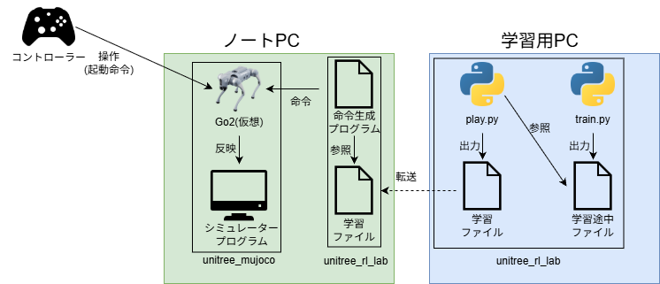
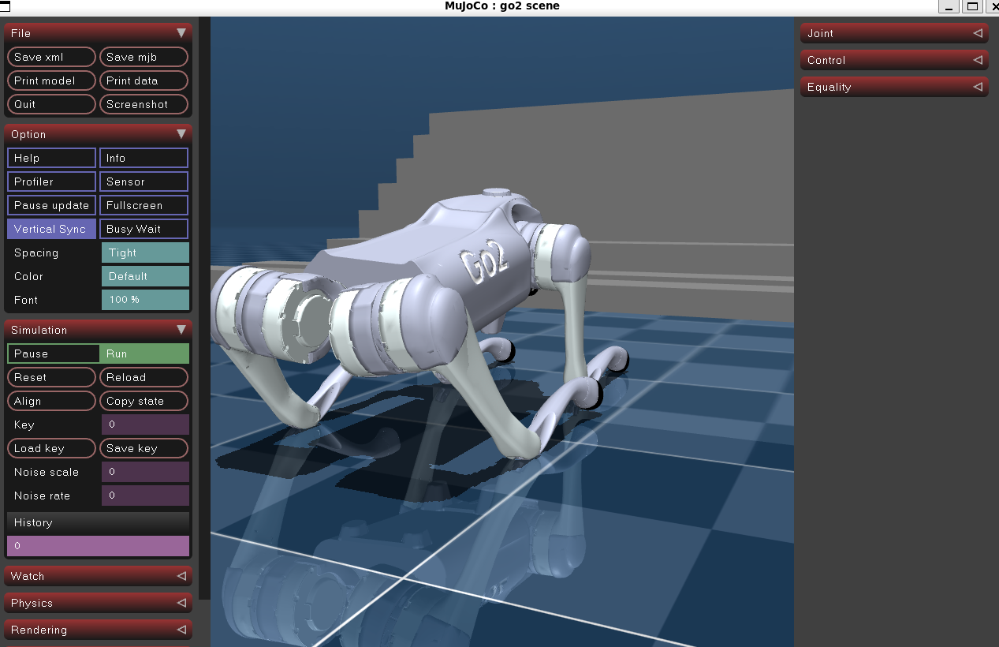

# 7. シミュレーター環境での実行

## 概要

本章では，第5章で学習した強化学習済みの方策を，MuJoCoのシミュレーター環境で実行し，コントローラーで操作して挙動を確認する手順について記述する．

## 前提条件

第3章のシミュレーション環境のセットアップと第5章の強化学習の実行が完了していること．本章では，ノートPC（Ubuntu 24.04）で作業する．

## 理論背景

学習用PC内で強化学習を行い得られた方策ファイルを，ノートPCのシミュレーター環境上に展開し，コントローラーからの入力を用いて学習済み方策の挙動を観測する．

本章のシステム構成を以下の図に示す．学習用PCでplay.pyを実行すると，学習済み方策がONNX形式のファイルとして書き出される．ノートPCでは，unitree_mujocoがコントローラーの入力とシミュレーター上のGo2の状態をDDS通信でgo2_ctrlに送り，go2_ctrlが方策を用いて各関節への指令を計算してunitree_mujocoに返す．



## 実装例

### 学習データファイルを生成する

unitree_rl_labの，強化学習を行った環境でplay.pyを動かすことで，必要な強化学習済みファイルがエクスポートされる．

```bash
cd ~/workspace/unitree_rl_lab
python scripts/rsl_rl/play.py --task Unitree-Go2-Velocity --num_envs 4 --headless 
```

### 学習データを学習用PCから転送する

学習用PCで生成したエクスポートファイルを，ノートPCへ転送する．

転送先は以下の通り．

```text
~/workspace/unitree_rl_lab/logs/rsl_rl/unitree_go2_velocity
```

転送方法としては，FileZillaなどのGUIツールを用いるか，scpコマンドを用いる．scpコマンドを用いる場合は，ノートPCで以下のコマンドを実行する．`<日時>`のフォルダごと転送する．

```bash
mkdir -p ~/workspace/unitree_rl_lab/logs/rsl_rl/unitree_go2_velocity
scp -r <ユーザー名>@<学習用PCのIPアドレス>:~/workspace/unitree_rl_lab/logs/rsl_rl/unitree_go2_velocity/<日時> ~/workspace/unitree_rl_lab/logs/rsl_rl/unitree_go2_velocity/
```

### 命令生成に用いる学習結果を指定

既定では，学習済みデータのうち最新のものが使用される．

明示的に指定する場合は，`unitree_rl_lab/deploy/robots/go2/config/config.yaml` の `policy_dir` を変更する．

設定例を以下に示す．

```yaml
...
  Velocity:
    transitions: 
      Passive: LT + B.on_pressed
    policy_dir: ../../../logs/rsl_rl/unitree_go2_velocity/2026-09-11_16-09-02/exported
```

### 起動

制御プログラムの起動(コントローラーの入力による命令生成)
```bash
cd ~/workspace/unitree_rl_lab/deploy/robots/go2/build
./go2_ctrl -n lo
```

シミュレーター本体
```bash
cd ~/workspace/unitree_mujoco/simulate/build
./unitree_mujoco
```



### Unitree Go2の操作(Simulator上)

- 必要な物
    - Xboxコントローラー(またはXboxコントローラーと認識されるもの)

1. L2+Aボタンを押してGo2を立ち上がらせる
2. STARTボタンを押して，強化学習結果を用いて動作するようにする
3. 操作(スティックによる移動・旋回等)
4. シミュレーター上のGo2の挙動を観察する

操作方法

| 操作 | コントローラーの操作 |
| --- | --- |
| 前進 | 左スティック上 |
| 後退 | 左スティック下 |
| 左移動 | 左スティック左 |
| 右移動 | 左スティック右 |
| 左旋回 | 右スティック左 |
| 右旋回 | 右スティック右 |
| L2 + A | Go2の立ち上げ |
| L2 + B | Go2を脱力させる（その場に座り込む） |
| START | 強化学習結果を用いた動作を開始・停止する |

---
